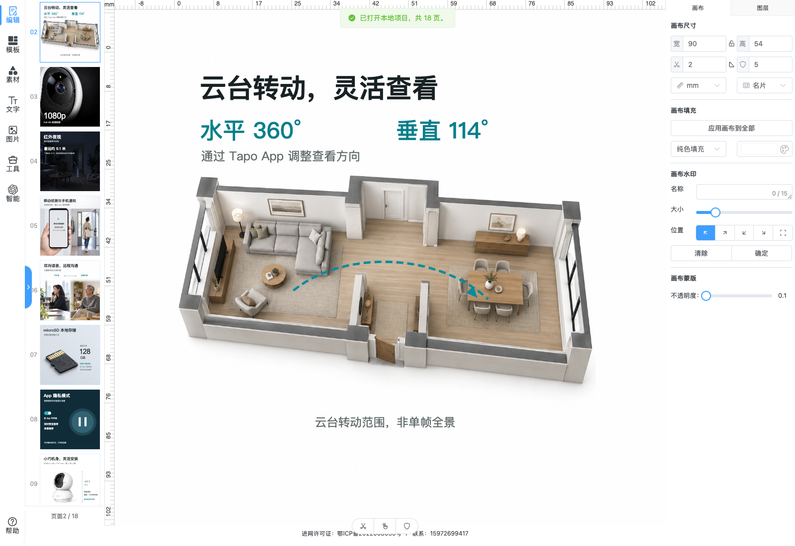

# YFT Design 本地画布编辑器

这是 [dromara/yft-design](https://github.com/dromara/yft-design) 的本地验证版重建说明。公开仓库只保存上游固定 commit 的来源信息和必要的本地覆盖文件，不整体收录上游源码快照、字体或图片资产。运行 setup 脚本会下载并校验固定 commit，再在未跟踪的 `workspace/editor-yft/` 目录重建编辑器。

上游介绍保存在 [README.upstream.md](README.upstream.md)；本地验证记录和已知边界见 [LOCAL-NOTES.md](LOCAL-NOTES.md)。上游 MIT 许可证原文见 [LICENSE](LICENSE)，请在复制、修改和分发时一并保留。

## 真实工程效果

以下是本项目 C200 第三版的 18 页商品工程在编辑器中打开的真实截图。对应完整主图、详情及保存重开测试画面见 [C200 案例图册](../../docs/showcase/c200-v3/README.md)。

[](../../docs/showcase/c200-v3/README.md#实际可编辑画面)

## 重建与启动

需要 Python 3.9 或更高版本（仅标准库）和网络访问。setup 会从 GitHub codeload 下载固定上游归档、校验 SHA-256、安全解压并应用本地覆盖文件；它拒绝覆盖已存在的目标目录，不安装 npm 依赖，也不运行上游脚本。

在仓库根目录执行：

```sh
python3 scripts/setup_editor.py
cd workspace/editor-yft
npm ci --ignore-scripts
npm run dev -- --host 127.0.0.1 --port 5178 --strictPort
```

打开 <http://127.0.0.1:5178/>。终端按 `Ctrl+C` 停止开发服务。Node.js `18.19.0` 是上游 package 配置声明的版本；本次重建安装与构建使用 Node 24.20.0 / npm 11.19.0。项目使用 `package-lock.json`，锁文件含 `registry.npmmirror.com` 下载地址。

如需指定新目标路径，可运行 `python3 scripts/setup_editor.py --dest ./tmp/editor-yft`，再进入该目录执行后续 npm 命令。目标必须不存在，脚本不会清理或覆盖已有内容。

`npm run build` 会运行 `vite build`，输出到 `dist/`，上游分析插件还会打开本地 `stats.html` 页面。生产构建只代表前端打包；它不会提供缺失的服务端 API。不要把 `npm run deploy` 当成本地预览步骤。

## 本地模式的范围

这里的“本地”指开发服务仅在本机打开，以及使用本地文件完成的一部分编辑和导出操作，不代表整个应用已离线化。开发服务器仍将 `/api`、`/static` 和 `/yft-static` 请求代理到 `http://127.0.0.1:8789`；本地没有运行对应后台时，在线模板、素材、字体和需要服务端解析或转换的功能无法正常使用。登录、抠图、PDF/PSD 等依赖接口的能力不应视为开箱可用。不要在此本地验证版中输入或保存真实账户凭据。

可用闭环已在本机 Chrome 中验证：打开编辑器、添加和编辑文字、插入及替换本地图片、导出项目 JSON、重新打开 JSON、再次修改并导出当前页 PNG。此验证不代表商品视觉质量验收、跨浏览器兼容或生产发布验收。

## 编辑、保存和重开项目

1. 首次进入时关闭引导弹窗。若左侧编辑面板折叠，点击画布侧边的蓝色箭头展开。
2. 左侧“文本”区可新增标题或普通文字；双击画布中的文字对象进入文字编辑。拖动对象可调整位置。选中对象后，可在右侧属性面板修改可用样式。
3. 在左侧“编辑”区点击“上传文件”，选择 PNG、JPEG、WebP 等本地图片，将其添加到当前页。选择已有图片对象后，可通过替换图片操作更新该图片。也可添加 SVG 或本地 MP4；MP4 使用浏览器临时对象 URL，不能当作可移植的项目资源。此处上传本地 JSON 会将其中模板页加入当前工作区。
4. 要保存可重开的整套工程，在右上角点击“下载”，选择“JSON”，使用“保存整个项目 JSON”导出。单页 JSON 与整套项目 JSON 用途不同；请保留整套项目文件以供后续继续编辑。
5. 重新打开时，在左侧“编辑”区点击“打开项目 JSON”，选择此前导出的项目文件。若当前工作区已有内容，确认替换后才会载入；取消则保留当前工作区。该操作只替换浏览器中的编辑工作区，不会删除或修改磁盘上的 JSON 文件。
6. 导出图片时，在右上角“下载”面板选择“导出图片”，选 PNG 或 JPEG，调整画质和分辨率后导出。当前只能导出当前页；“全部页面”选项不可用。SVG 导出调用本地画布序列化与文件下载；PDF/PSD 转换另行依赖服务端。SVG 的图层与字体表现仍需在接收工具中复验。

## 工程文件与素材可移植性

项目 JSON 用于保存画布页和图层数据，不是将整个项目文件夹打包的归档格式。通过本地文件插入的图片会以图像数据写入导出 JSON，文件可能因此变大；这类数据随 JSON 移动通常比外部引用更可靠。若项目图层引用外部 URL、机器本地路径或临时对象 URL，JSON 不会自动打包该 URL 对应的原始文件。其他设备或浏览器无法访问该路径、链接失效、需要登录，或服务器不允许跨域读取时，图片可能丢失、无法显示或导出失败。分享工程时应使用可访问且稳定的资源地址，或在本地重新嵌入图片后导出，并在目标设备重新打开检查。

浏览器工作区不是长期自动备份。请定期导出项目 JSON，并自行保管。导入工程会替换当前工作区，操作前先保存需要保留的内容。

## 已知限制与验证边界

- 默认画布不是电商平台规格模板；页面尺寸、主图与详情顺序仍需按实际用途设置和逐页检查。
- 多页图片批量导出未实现；当前图像导出只支持当前页。
- 在线模板、素材和字体、AI 抠图、字体转曲、视频处理、PDF/PSD 转换等能力未完成本地服务验证，其中部分需要未部署的服务端 API。
- 未验证手机端编辑、跨浏览器兼容、跨设备 URL 资源迁移以及多商品批处理。
- `vue-tsc --noEmit` 曾受上游 TypeScript 配置问题阻断（`CanvasTour/index.vue.js` 被按 TypeScript 输入处理）；2026-10-15 的固定版本重建与 Vite 生产构建已通过，详情见 [验证记录](../../docs/verification.md)。该构建不运行完整类型检查，也不证明生产部署和后台功能已验收。
- 目前状态是“本地编辑核心闭环通过的技术验证副本”，不是完整、离线或可直接商用的软件交付。

## 上游与本地修改

上游项目： [dromara/yft-design](https://github.com/dromara/yft-design)，上游原始项目说明见 [README.upstream.md](README.upstream.md)。当前副本在上游代码基础上包括 OpenType 导入解析修复、本地 SVG/JSON/图片/视频文件处理、本地单页或多页 Template JSON 导入、整套项目 JSON 校验与替换、页面切换时同步活动画布，以及禁用尚未实现的多页图片导出等修改。验证细节见 [LOCAL-NOTES.md](LOCAL-NOTES.md)。

本地修改保留上游 MIT 许可证。分发时请保留 [LICENSE](LICENSE)，并将上游来源与本地修改一并说明。
